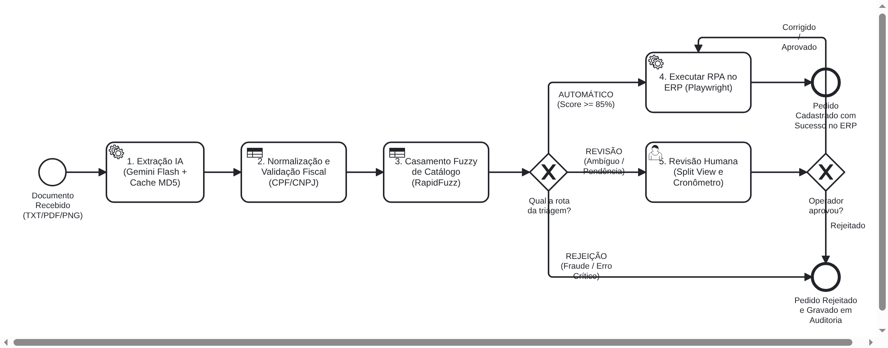

# Automação Inteligente de Processos (IPA) para MPMEs

[](https://www.python.org/downloads/)
[](https://docs.astral.sh/uv/)
[](LICENSE)
[](docs/diagramas/bpmn_to_be.bpmn)
[](CITATION.cff)

Pipeline de **Automação Inteligente de Processos (Intelligent Process Automation - IPA)** para ingestão, validação determinística, triagem inteligente e lançamento automatizado de pedidos de compra em formatos não estruturados (PDF, PNG e TXT) em sistema ERP.

Desenvolvido como projeto de Trabalho de Conclusão de Curso (TCC) em Sistemas de Informação, o sistema combina:
- **Extração Multimodal com LLM**: Modelo `gemini-2.5-flash` estruturado sob schemas Pydantic tipados com cache criptográfico determinístico (100% de reproducibilidade).
- **Validação e Normalização Determinística**: Motor de regras locais com cálculo oficial de dígitos verificadores de CPF/CNPJ (Receita Federal), casamento aproximado (*Fuzzy Matching* via RapidFuzz) contra catálogo oficial `P-001` a `P-040` e filtro ativo contra *Prompt Injection*.
- **Orquestrador BPMN 2.0 e Triagem em 3 Vias**: Máquina de estados formal que despacha pedidos para **AUTOMÁTICO** (RPA direto), **REVISÃO** (Fila Humana com interface Split View) ou **REJEIÇÃO** (bloqueio preventivo de segurança).
- **Execução RPA Idempotente**: Robô baseado em Playwright Chromium com garantia de duplicidade zero no lançamento relacional do ERP corporativo.

---

## Resultados Experimentais e Validação Científica

A esteira foi submetida a uma bateria experimental com 50 documentos do conjunto de teste e 30 pedidos pareados no teste de produtividade humana:

| Hipótese de Pesquisa | Meta Teórica Definida | Resultado Empírico Observado | Veredito Científico |
| :--- | :--- | :--- | :---: |
| **$H_1$: Produtividade e Latência** | Redução $\ge 50\%$ do tempo operacional | Redução de **87,9%** (Speed-up de 8,2x: 74,4s p/ 9,0s) | **CONFIRMADA** |
| **$H_2$: Acurácia da Extração** | F1-Score $\ge 0,85$ nos campos críticos | F1 de **0,9883** e Acurácia exata de **96,0%** | **CONFIRMADA** |
| **$H_3$: Controle de Erro Residual** | Erro residual no ERP $\le 2,0\%$ com $\tau \ge 0,85$ | **0,0% de erro residual** (Cobertura de 72,0%) | **CONFIRMADA** |
| **$H_4$: Resiliência e Idempotência** | Taxa de duplicidade = 0% em reexecução | **0% de duplicidade** (100% idempotência no reenvio) | **CONFIRMADA** |

Consulte o relatório completo com discussão factual e gráficos científicos:
- 📊 **[Relatório Completo de Resultados (RESULTADOS.md)](results/RESULTADOS.md)**
- 📈 **[Gráficos Científicos G1 a G6 (results/figures/)](results/figures/)**
- 📋 **[Tabelas Estatísticas T1 a T6 em Markdown e CSV (results/tables/)](results/tables/)**
- 📸 **[Prints Ilustrativos Oficiais P1 a P5 (docs/prints/)](docs/prints/)**
- 🛡️ **[Ameaças à Validade Metodológica (docs/ameacas_validade.md)](docs/ameacas_validade.md)**

---

## Fluxo da Esteira (Arquitetura BPMN 2.0 TO-BE)

[](docs/diagramas/bpmn_to_be.svg)

> **Modelagem Oficial**: [`bpmn_to_be.bpmn`](docs/diagramas/bpmn_to_be.bpmn) (editável no [bpmn.io](https://demo.bpmn.io)) • [Vetor SVG](docs/diagramas/bpmn_to_be.svg) • [Documentação dos diagramas](docs/diagramas/README.md)

### Resumo Lógico da Triagem

```text
[ Documento de Entrada ] (TXT, PDF, PNG em data/inbox/)
          │
          ▼
[ Extração Multimodal ] (Gemini Flash + .ai_cache.json)
          │
          ▼
[ Validação e Regras ] (RapidFuzz, cálculo fiscal, barreira injection)
          │
    ┌─────┴─────────────────────────┐
    ▼                               ▼                               ▼
[ Via Verde - AUTOMATICO ]      [ Via Amarela - REVISAO ]       [ Via Vermelha - REJEICAO ]
Confiança >= 0.85               Confiança < 0.85 ou             Ataque de Prompt Injection /
Sem violações de regra          Divergência sutil de catálogo   Fraude estrutural
    │                               │                               │
    ▼                               ▼                               ▼
[ Robô RPA (Playwright) ]       [ Fila Human-in-the-Loop ]       [ Bloqueio com Log ]
    │                           (Interface Split View)
    └───────────────┬───────────────┘
                    ▼
          [ ERP Corporativo ] (Idempotência garantida por chave ref_externa)
```

---

## Estrutura do Repositório

```text
tcc-ipa/
├── config/       # Regras de negócio em YAML (limiares, catálogo P-001 a P-040, validações)
├── data/         # Ingestão (inbox/), gabarito oficial (gold/), geradores e splits
├── docs/         # Dicionário do sistema, guias operacionais, diário, BPMN e prints P1 a P5
│   ├── diagramas/    # Diagrama de processo BPMN 2.0 (XML, PNG, SVG)
│   └── prints/       # Prints ilustrativos oficiais de telas e terminal (P1 a P5)
├── erp_sim/      # ERP web simulado (FastAPI + Jinja2 + Supabase)
├── eval/         # Bateria experimental científica (EXP1 a EXP7), figuras e tabelas
├── results/      # Resultados consolidados
│   ├── figures/      # Gráficos vetoriais de alta resolução (G1 a G6 em PNG)
│   ├── raw/          # CSVs brutos coletados nos experimentos
│   ├── tables/       # Tabelas T1 a T6 em Markdown (.md) e CSV (.csv)
│   └── RESULTADOS.md # Relatório factual e discussão dos resultados
├── rpa/          # Robô de automação de interface com Playwright Chromium
├── scripts/      # Utilitários operacionais e de manutenção
├── src/ipa/      # Núcleo da esteira IPA (AI extractor, regras determinísticas, orquestrador)
└── tests/        # Suíte de testes automatizados unitários e de integração (pytest)
```

---

## Instalação e Execução

### Pré-requisitos
- Python 3.12+
- Gerenciador [`uv`](https://docs.astral.sh/uv/) (Astral)

### 1. Clonar e sincronizar ambiente
```bash
git clone https://github.com/jonnguii/tcc-ipa.git
cd tcc-ipa
uv sync
uv run playwright install chromium
```

### 2. Configuração do `.env`
Copie o arquivo de exemplo:
```bash
cp .env.example .env
```

Para reprodução offline imediata pela banca avaliadora, o projeto vem pré-configurado em **Modo Replay**, permitindo rodar 100% dos experimentos sem custo de API e sem dependência de internet:
```dotenv
GEMINI_API_KEY=dummy_offline_key
GEMINI_MODEL=gemini-2.5-flash
AI_MODE=replay
EXECUTOR=stub
ERP_BASE_URL=http://localhost:8000
ERP_SABOTAGE=none
RPA_HEADLESS=true
```

*(Opcional) Caso deseje executar chamadas ao vivo contra a API do Google Gemini, altere `AI_MODE=record` e preencha sua chave obtida no [Google AI Studio](https://aistudio.google.com/).*

---

## Execução dos Experimentos Científicos

### 1. Reproduzir a Bateria Completa de Experimentos (EXP1 a EXP7)
Para reexecutar todos os experimentos da esteira e consolidar as tabelas estatísticas e gráficos:
```bash
uv run python eval/rodar_experimentos.py
```

### 2. Gerar Gráficos Científicos e Tabelas
```bash
uv run python eval/charts.py
```
As tabelas serão atualizadas em `results/tables/` (versões `.md` e `.csv`) e as figuras em `results/figures/` (PNG a 300 DPI).

### 3. Gerar Prints Ilustrativos Oficiais (P1 a P5)
```bash
uv run python eval/generate_prints.py
```
Os 5 prints de evidências de tela serão salvos em `docs/prints/`.

### 4. Executar Testes Automatizados
```bash
uv run pytest
```

---

## Como Citar este Trabalho

Consulte o arquivo [`CITATION.cff`](CITATION.cff) para detalhes completos de citação. Exemplo em formato ABNT:

> Dioog Gomes, Gabriel Januario e Joao Guilherme. **Arquitetura de Automação Inteligente de Processos (IPA) para Triagem e Lançamento de Pedidos em Micro, Pequenas e Médias Empresas (MPMEs)**. Trabalho de Conclusão de Curso (Graduação em Sistemas de Informação), 2026. Disponível em: <https://github.com/jonnguii/tcc-ipa>.

---

## Licença

Este projeto é disponibilizado sob a licença [MIT](LICENSE).
