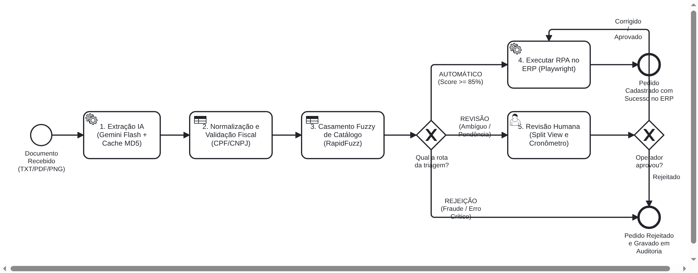
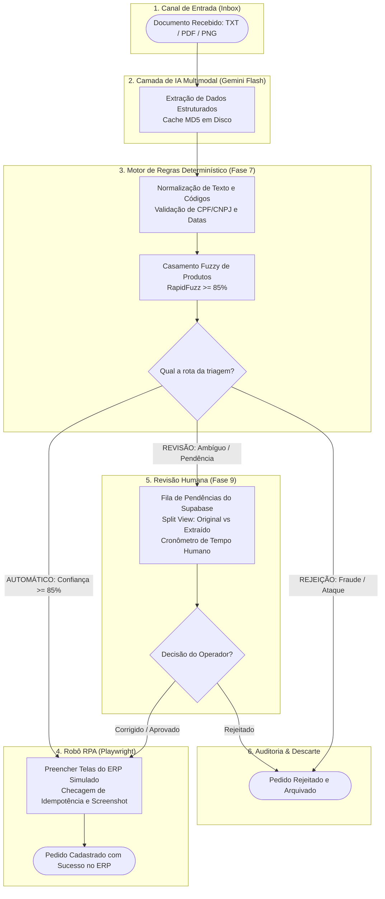

# Diagramas de Processo do TCC: Arquitetura TO-BE

Este diretório contém a modelagem dos processos de negócio e automação inteligente do TCC.

## Diagrama Oficial BPMN 2.0 (Arquitetura TO-BE)

### Formatos Disponíveis
- **Modelo Oficial BPMN 2.0**: [`bpmn_to_be.bpmn`](bpmn_to_be.bpmn) — segue a especificação internacional BPMN 2.0 da OMG e pode ser aberto e editado diretamente no [bpmn.io](https://demo.bpmn.io).
- **Vetor SVG**: [`bpmn_to_be.svg`](bpmn_to_be.svg) — gráfico vetorial escalável com fundo otimizado para visualização em temas claro e escuro.
- **Imagem PNG (Alta Resolução)**: [`bpmn_to_be.png`](bpmn_to_be.png) — renderização 2x (Retina) para visualização rápida no GitHub, documentações e relatórios.

---

## Fluxograma Visual do Processo TO-BE

