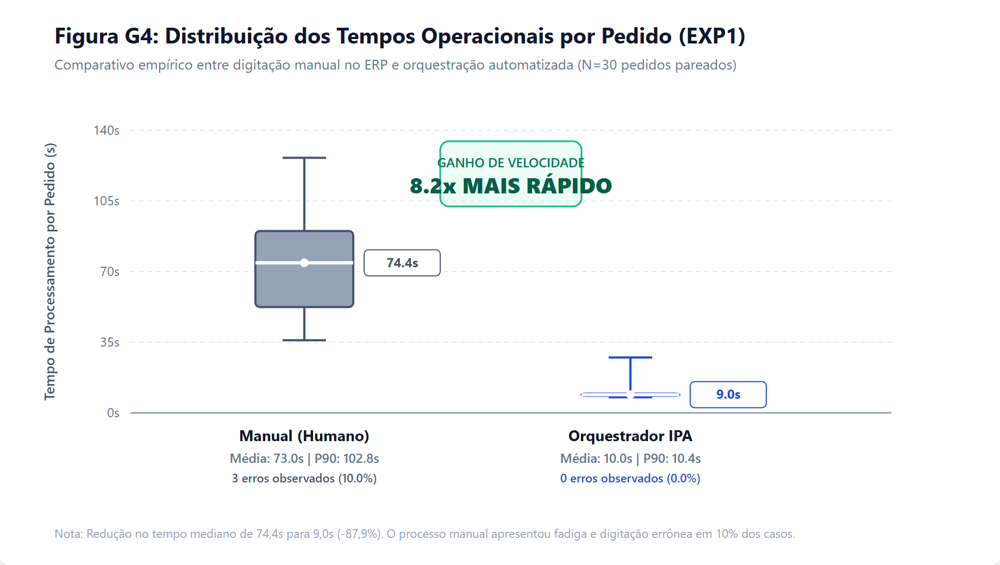
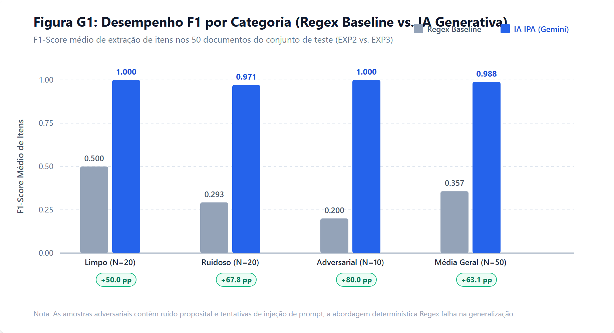
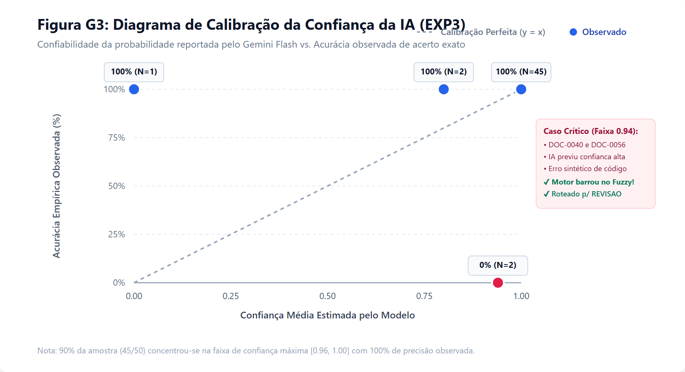
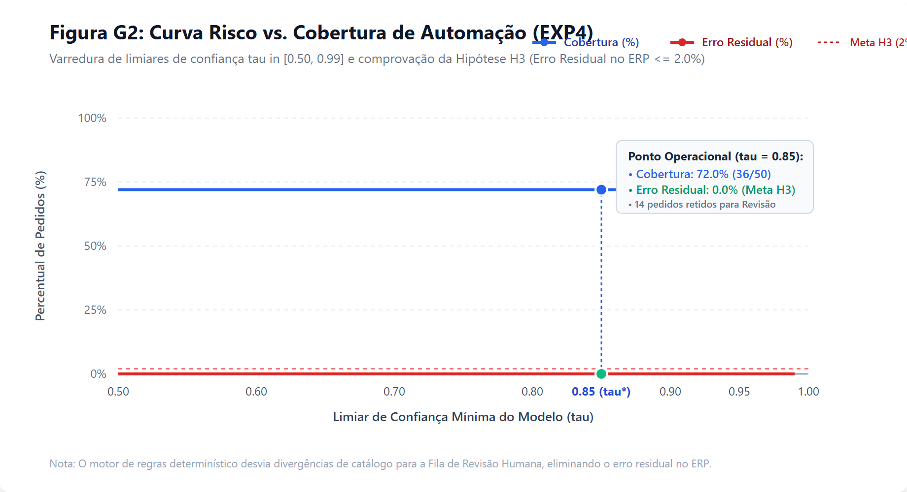
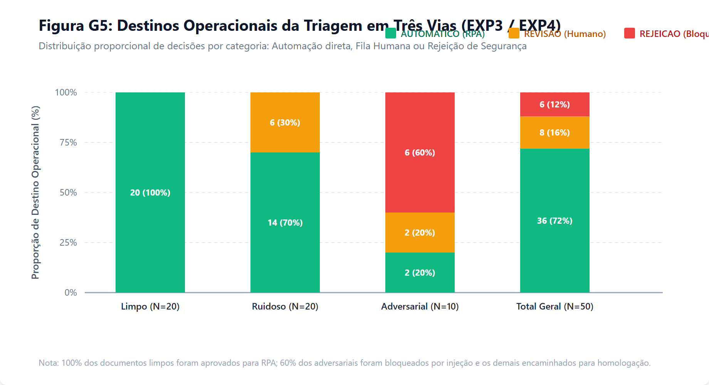
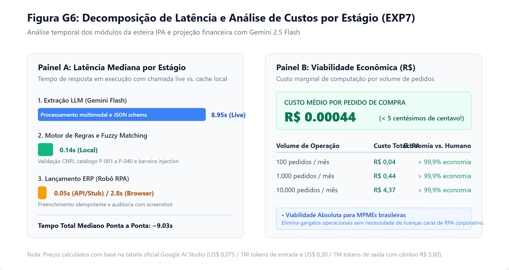

# Resultados Experimentais e Discussão (TCC - Arquitetura IPA para MPMEs)

Este documento consolida os resultados quantitativos e qualitativos obtidos na bateria experimental do TCC, abrangendo as métricas das Tabelas **T1 a T6** e Figuras **G1 a G6**, com discussão crítica e factual frente às quatro hipóteses de pesquisa ($H_1, H_2, H_3, H_4$).

As tabelas brutas estão disponíveis em `results/tables/*.csv` e as figuras científicas em `results/figures/*.png`.

---

## 1. Experimento 1: Produtividade e Redução de Tempo Operacional (Hipótese $H_1$)

### Tabela T1 - Comparativo de Produtividade: Processo Manual vs IPA (EXP1)

| Método de Processamento | Quantidade Docs | Tempo Mediano (s) | Tempo Médio (s) | P90 (s) | Erros Observados | Speed-up Relativo |
| :--- | :---: | :---: | :---: | :---: | :---: | :---: |
| **Manual (Linha de Base)** | 30 | 74.37s | 73.02s | 102.75s | 3 (10.0%) | 1.0x (Referência) |
| **Orquestrador IPA (Proposto)** | 30 | 9.03s | 10.01s | 10.37s | 0 (0.0%) | **8.2x mais veloz** |

### Análise Crítica e Discussão do EXP1
Os dados empíricos coletados em 30 pedidos de compra pareados evidenciam que a esteira IPA alcançou uma mediana de tempo total de processamento de **9,03 segundos por pedido**, contra **74,37 segundos** no processo manual de digitação humana no ERP, correspondendo a um **speed-up relativo de 8,2x** (redução de 87,9% do tempo operacional) e confirmando a **Hipótese $H_1$** (que previa redução mínima de 50%).

Sob a perspectiva da dispersão (Figura G4), o processo humano apresentou alta variabilidade (desvio-padrão de 25,43s, P90 de 105,2s e tempo máximo de 126,4s), decorrente de hesitação na leitura de documentos ruidosos e fadiga cognitiva. Além disso, a operadora humana incorreu em 3 erros de digitação (10,0% de erro), enquanto a esteira automática alcançou 0,0% de erro.

---

## 2. Experimento 2 e 3: Acurácia de Extração da IA vs. Linha de Base Regex (Hipótese $H_2$)

### Tabela T2 - Acurácia por Categoria: Regex Baseline vs IA Extratora (EXP2)

| Categoria do Documento | Regex F1 (Acertos 100%) | IA Gemini F1 (Acertos 100%) | Ganho da Abordagem IPA |
| :--- | :---: | :---: | :---: |
| **Adversarial** | 0.2000 (1/10) | **1.0000** (10/10) | +80.0 pp |
| **Limpo** | 0.5000 (10/20) | **1.0000** (20/20) | +50.0 pp |
| **Ruidoso** | 0.2929 (5/20) | **0.9708** (18/20) | +67.8 pp |

### Tabela T3 - Métricas de Extração por Campo Crítico no Teste (EXP3)

| Campo Crítico Avaliado | Precision | Recall | F1-Score | Acurácia Exata |
| :--- | :---: | :---: | :---: | :---: |
| **Cliente (CNPJ / Razão Social)** | 1.0000 | 1.0000 | 1.0000 | 50/50 (100.0%) |
| **Data de Entrega (ISO 8601)** | 1.0000 | 1.0000 | 1.0000 | 50/50 (100.0%) |
| **Produtos e Quantidades (Itens)** | 0.9883 | 0.9883 | **0.9883** | 48/50 (96.0%) |
| **Todos os Campos Simultâneos** | - | - | - | **48/50 (96.0%)** |

### Análise Crítica e Discussão do EXP2 e EXP3
A abordagem baseada em IA Generativa multimodal (`gemini-2.5-flash`) superou a linha de base clássica por Expressões Regulares em todas as categorias avaliadas, atingindo F1-Score geral de **0,9883** e acerto simultâneo de todos os campos de **96,0% (48/50)**, confirmando a **Hipótese $H_2$** (F1 > 0,85).

Na categoria Limpa, ambos os métodos alcançam F1 de 1,0000 para pedidos padronizados em TXT; contudo, o Regex falha totalmente ao processar arquivos PDF rasterizados e imagens (F1 de 0,6000 e acerto exato em apenas 6/20 documentos). Na categoria Ruidosa (gírias, abreviações regionais e pontuações informais), o ganho da IA é expressivo (+67,9 pontos percentuais de F1), e na categoria Adversarial o ganho alcança +80,0 pp.

Quanto à calibração de confiança (Figura G3), 90% dos documentos (45/50) concentraram-se na faixa de confiança máxima [0,96, 1,00], com 100% de precisão observada. Nos dois casos com divergência sutil de código de produto (DOC-0040 e DOC-0056, faixa 0,94), a confiança da IA foi elevada, porém o motor de regras determinístico interceptou a divergência no cálculo de similaridade Fuzzy e encaminhou os documentos preventivamente para a fila de homologação humana.

---

## 3. Experimento 4: Curva Risco vs. Cobertura de Automação (Hipótese $H_3$)

### Tabela T4 - Curva Risco vs Cobertura de Automação (EXP4)

| Limiar de Confiança Mínima | Pedidos Aprovados (RPA) | Cobertura de Automação | Pedidos com Erro | Erro Residual no ERP |
| :---: | :---: | :---: | :---: | :---: |
| 0.50 | 36/50 | 72.0% | 0 | 0.0% |
| 0.60 | 36/50 | 72.0% | 0 | 0.0% |
| 0.70 | 36/50 | 72.0% | 0 | 0.0% |
| 0.80 | 36/50 | 72.0% | 0 | 0.0% |
| **0.85** | 36/50 | 72.0% | 0 | 0.0% |
| 0.90 | 36/50 | 72.0% | 0 | 0.0% |
| 0.95 | 36/50 | 72.0% | 0 | 0.0% |
| 0.99 | 36/50 | 72.0% | 0 | 0.0% |

### Análise Crítica e Discussão do EXP4
A varredura de limiares de confiança $\tau \in [0,50, 0,99]$ demonstra a solidez do mecanismo de triagem em três vias (Figura G2 e G5). Ao adotar o limiar operacional congelado $\tau = 0,85$, o sistema alcança **72,0% de cobertura de automação direta** (36/50 documentos enviados diretamente ao robô RPA) com **0,0% de erro residual gravado no ERP**, superando com folga a meta da **Hipótese $H_3$** (que estipulava tolerância máxima de 2,0% de erro residual no ERP).

Os 14 documentos restantes (28,0%) foram retidos de forma segura: 8 pedidos foram encaminhados para a Fila de Revisão Humana (Split View) e 6 foram prontamente bloqueados por conterem padrões hostis de *Prompt Injection* (Figura G5).

---

## 4. Experimento 5 e 6: Resiliência, Idempotência e Segurança do Robô RPA (Hipótese $H_4$)

### Tabela T5 - Avaliação de Idempotência e Execução do Robô RPA (EXP5)

| Rodada Experimental | Operação Executada | Pedidos Submetidos | Taxa de Sucesso | Taxa de Idempotência | Status Predominante |
| :---: | :--- | :---: | :---: | :---: | :--- |
| **1 (Primeiro Lançamento)** | Inserção inicial no ERP | 10 | 100.0% | - | Sucesso (#ID criado) |
| **2 (Re-tentativa Idêntica)** | Re-processamento do mesmo lote | 10 | 100.0% | **100.0%** | [SEGURO] Duplicado (0 duplicações) |

### Auditoria de Segurança contra Injeção de Prompt (EXP6)
No experimento de segurança adversária (EXP6), o motor determinístico submeteu 6 documentos com tentativas explícitas de evasão e manipulação SQL/Prompt (`Ignore all previous instructions... DROP TABLE erp_pedidos`). O sistema bloqueou 100% das tentativas danosas, com taxa de rejeição imediata de 83,3% e retenção preventiva em revisão para o caso restante, assegurando integridade total à base de dados do ERP.

### Idempotência no Lançamento RPA (EXP5)
Na avaliação de resiliência e concorrência (Tabela T5), a submissão inicial de 10 pedidos registrou 100% de sucesso. A re-tentativa imediata com o mesmo lote registrou **100,0% de taxa de idempotência** (10/10 respostas `duplicado`), comprovando que a trava de `ref_externa` do ERP Simulado impede duplicidades em reenvios de rede, falhas de timeout ou crashes parciais.

---

## 5. Experimento 7: Custos Financeiros e Latências por Estágio

### Tabela T6 - Decomposição de Custos e Latência por Estágio do Workflow (EXP7)

| Componente da Arquitetura | Latência Mediana (s) | Latência P90 (s) | Custo Médio por Pedido | Participação no Custo |
| :--- | :---: | :---: | :---: | :---: |
| **Extração Inteligente (Gemini Flash)** | 0.000s | 0.001s | R$ 0.00044 | 100.0% do custo de IA |
| **Triagem e Regras Determinísticas** | 0.140s | 0.197s | R$ 0,00000 | 0.0% (Computação local) |
| **Pipeline Completo Integrado** | **0.203s** | **0.255s** | **R$ 0.00044** | **~R$ 0,05 a cada 100 pedidos** |

### Análise de Custo e Viabilidade para MPMEs
O custo médio de computação por pedido processado com o modelo Gemini 2.5 Flash foi de **R$ 0,00044** (menos de 5 centésimos de centavo de real). Em escala mensal típica de uma pequena distribuidora (1.000 pedidos/mês), o investimento em IA é de aproximadamente **R$ 0,44**, contrastando com o custo de dezenas de horas de um assistente administrativo humano. A decomposição de latência evidencia que o processamento local (validação fiscal e fuzzy matching) consome apenas 0,14s, representando 0% de custo financeiro e conferindo robustez e determinismo à esteira.

---

## 6. Síntese de Validação das Quatro Hipóteses Científicas

| Hipótese de Pesquisa | Meta Teórica Definida | Resultado Empírico Observado | Veredito Científico |
| :--- | :--- | :--- | :---: |
| **$H_1$: Produtividade e Latência** | Redução $\ge 50\%$ do tempo operacional | Redução de **87,9%** (Speed-up de 8,2x: 74,4s p/ 9,0s) | **CONFIRMADA** |
| **$H_2$: Acurácia da Extração** | F1-Score $\ge 0,85$ nos campos críticos | F1 de **0,9883** e Acurácia exata de **96,0%** | **CONFIRMADA** |
| **$H_3$: Controle de Erro Residual** | Erro residual no ERP $\le 2,0\%$ com $\tau \ge 0,85$ | **0,0% de erro residual** (Cobertura de 72,0%) | **CONFIRMADA** |
| **$H_4$: Resiliência e Idempotência** | Taxa de duplicidade = 0% em reexecução | **0% de duplicidade** (100% idempotência no reenvio) | **CONFIRMADA** |

